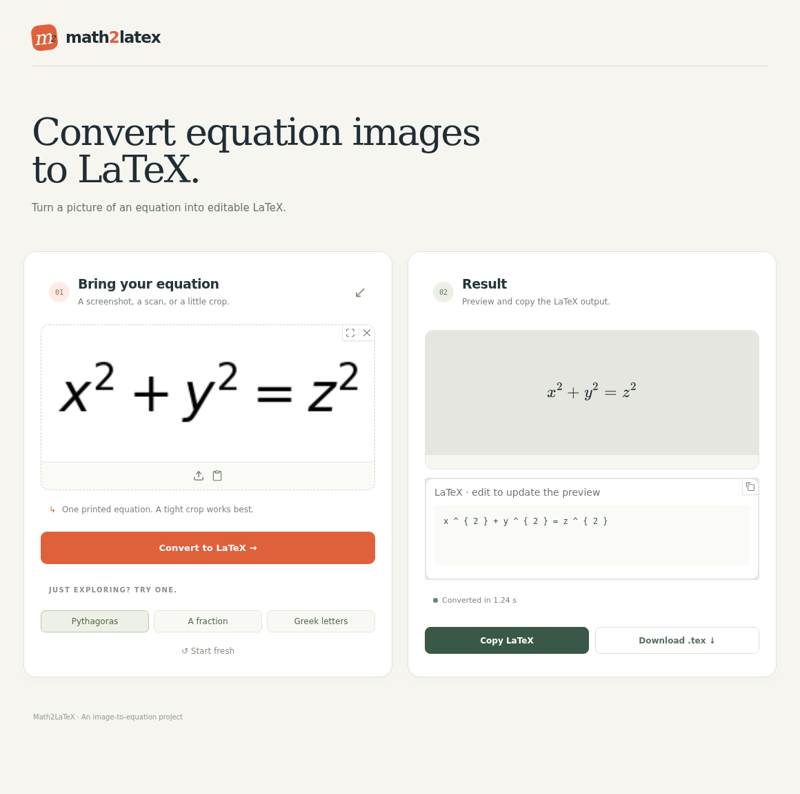

<div align="center">

# Math2LaTeX

### Convert equation images to LaTeX.

Upload a screenshot. Edit the result. Copy the code.

**[Try the demo](https://huggingface.co/spaces/msdkhairi/math2latex)** · **[Explore the demo source](https://huggingface.co/spaces/msdkhairi/math2latex/tree/main)** · **[Run locally](#run-locally)**

</div>

[](https://huggingface.co/spaces/msdkhairi/math2latex)

Math2LaTeX turns images of printed equations into editable LaTeX. Bring in a formula from a paper, slide, or screenshot, then view the typeset equation alongside its source code. Make corrections directly in the editor and take the result into your document.

## Try it

1. Open the **[Hugging Face demo](https://huggingface.co/spaces/msdkhairi/math2latex)**.
2. Upload or paste a cropped equation image—or choose one of the built-in examples.
3. Click **Convert to LaTeX** and review the result.
4. Edit the code to update the preview, then **Copy LaTeX** or **Download .tex**.

For best results, use one tightly cropped printed equation with clear contrast.

## What you can do

| Feature | How it helps |
| --- | --- |
| **Upload or paste** | Use a saved image or bring a screenshot straight from your clipboard. |
| **Try an example** | Explore the converter with equations already included in the app. |
| **Edit with a live preview** | Adjust the LaTeX and see the rendered equation update. |
| **Fit longer equations** | The preview scales to the available width on desktop and mobile. |
| **Copy or download** | Copy the LaTeX, or download a `.tex` document to keep working. |

## Run locally

The runnable demo is available from the Space's source repository. Use **Python 3.11 or 3.12** and the [Hugging Face CLI](https://huggingface.co/docs/huggingface_hub/guides/cli).

```bash
hf download msdkhairi/math2latex --type space --local-dir math2latex-demo
cd math2latex-demo

python3.11 -m venv .venv
source .venv/bin/activate
python -m pip install -r requirements.txt
python app.py
```

Open **http://127.0.0.1:7860** in your browser. If you use Python 3.12, replace `python3.11` in the command above with `python3.12`.

On Linux, the system libraries listed in `packages.txt` must also be available. The app prepares its required assets on first launch.

## Explore the project

This repository contains the original project implementation. The current demo application and its runtime files are available in the **[Space's Files tab](https://huggingface.co/spaces/msdkhairi/math2latex/tree/main)**.

| Directory | Contents |
| --- | --- |
| [`math2latex/model/`](math2latex/model) | Image-to-sequence network components. |
| [`math2latex/data/`](math2latex/data) | Image preprocessing and tokenization. |
| [`math2latex/runner/`](math2latex/runner) | Training and evaluation modules. |
| [`math2latex/config/`](math2latex/config) | Experiment configuration. |
| [`assets/`](assets) | Project visuals and demo screenshots. |

## License

The code in this repository is released under the **[MIT License](LICENSE)**.
